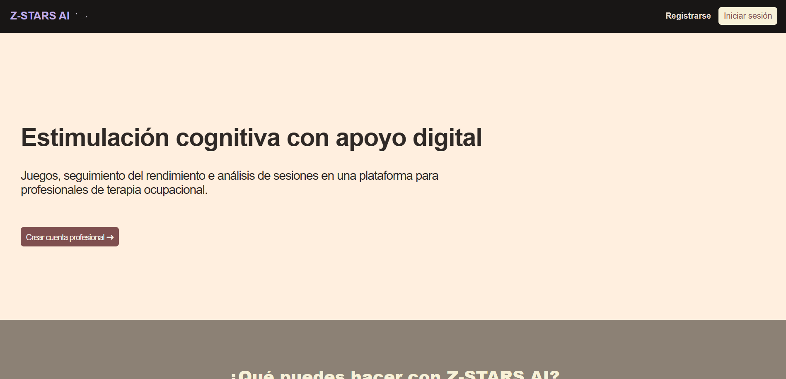
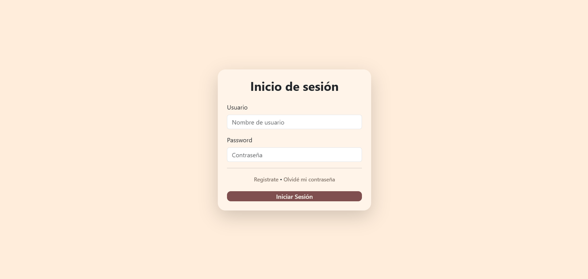
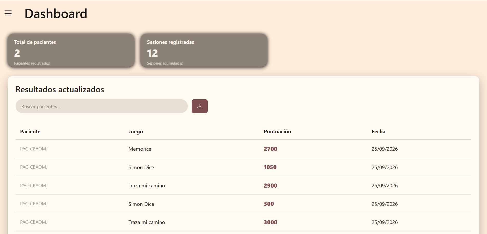
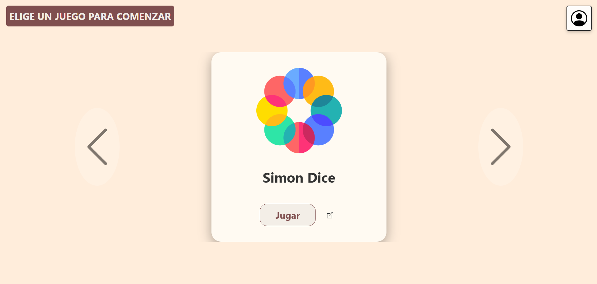
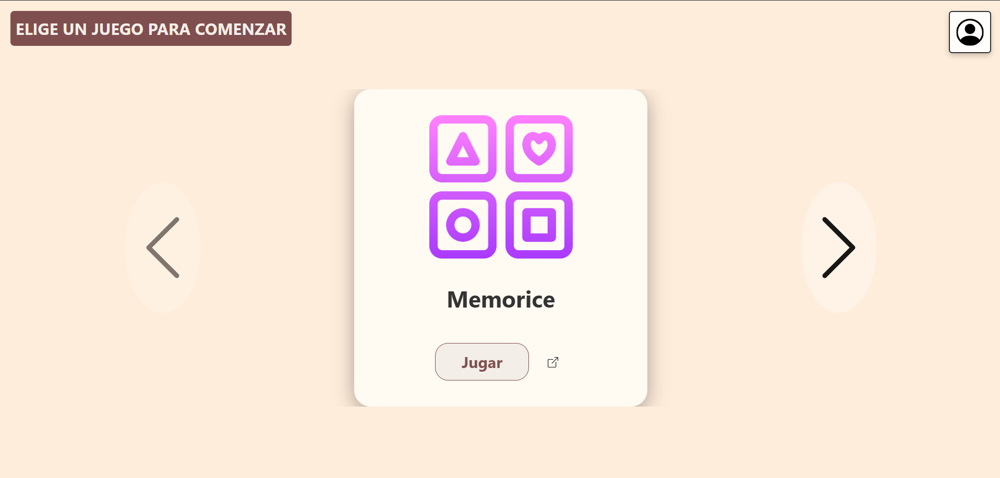
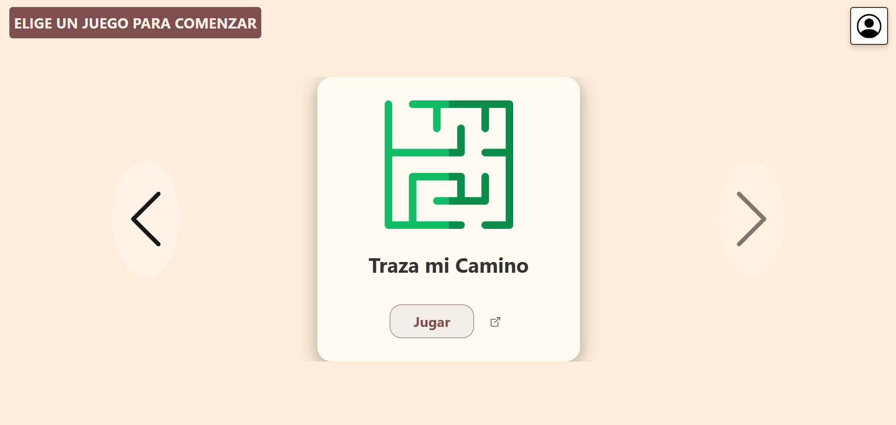

# Z-STARS AI 


**Cognitive assessment support platform for occupational therapy.**

Z-STARS AI is a web application designed to support occupational therapists in evaluating executive-function-related performance through interactive cognitive games. The platform collects behavioral metrics during gameplay, processes session data on the backend, and integrates machine learning to generate performance classifications and complementary AI-assisted analysis.

🌐 **Live Demo:** [https://zstars-ai.com](https://zstars-ai.com)

## Why this project?

Z-STARS AI began as my Computer Engineering capstone project. Rather than treating it as a one-time academic assignment, I continued developing it into a deployed web 
application.

The project evolved through backend development, interactive game design, data processing, machine learning integration, security enhancements, and cloud deployment.

It represents the practical application of software engineering, data analysis, and AI to a domain-specific problem.

## Highlights
- Production deployment with a custom domain.
- Machine learning integration using Random Forest.
- Interactive cognitive games with behavioral data collection.
- Clinical-oriented dashboard with historical performance tracking.
- AI-assisted analysis using Groq.
- Two-factor authentication (TOTP).
- Dockerized application.
- Cloud deployment using Render and Cloudflare.

## Key Features
- Interactive cognitive assessment games.
- Behavioral metrics collection during gameplay.
- Machine learning-based performance classification.
- Dashboard with historical progress visualization.
- AI-assisted analysis of assessment results.
- User authentication and two-factor security.
- Backend data processing and persistence.

## Problem

Traditional assessment workflows may involve challenges such as:

- Manual data collection and evaluation.
- Limited interactive assessment experiences.
- Time-consuming result analysis.
- Difficulty tracking performance over time.

Z-STARS AI explores how interactive software, behavioral data collection, and computational analysis can support assessment workflows through a centralized digital platform.

## System Architecture

```
                     ┌──────────────────────┐
                     │        User         │
                     └──────────┬───────────┘
                                │
                                ▼
                     ┌──────────────────────┐
                     │ Browser / Frontend  │
                     │ JavaScript / UI     │
                     └──────────┬───────────┘
                                │
                          REST / HTTP
                                │
                                ▼
                     ┌──────────────────────┐
                     │   Django Backend     │
                     │    Django REST      │
                     └──────────┬───────────┘
                                │
               ┌────────────────┼────────────────┐
               │                │                │
               ▼                ▼                ▼
       ┌──────────────┐ ┌──────────────┐ ┌──────────────┐
       │ PostgreSQL  │ │ ML Pipeline  │ │  Groq API   │
       │ Data Storage │ │ Random Forest│ │ AI Analysis │
       └──────────────┘ └──────┬───────┘ └──────────────┘
                              │
                              ▼
                    ┌────────────────────┐
                    │  Classification    │
                    │  Stable           │
                    │  Improvement      │
                    │  Decline          │
                    └────────────────────┘
```

## Technology Stack 
| Layer | Technologies |
|--------|--------------|
| Backend | Python 3.12, Django, Django REST Framework |
| Frontend | JavaScript, Bootstrap, Chart.js |
| Database | PostgreSQL, SQLite (local development) |
| Machine Learning | Scikit-learn, Random Forest |
| Infrastructure | Docker, Render, Cloudflare |
| AI  | Groq API|
| Email  | Resend |
| Security  | TOTP, encrypted secret storage|

## Machine Learning Pipeline
Z-STARS AI incorporates a Random Forest classifier  that processes behavioral metrics collected during cognitive game sessions.

The pipeline evaluates gameplay data and generates a performance classification that is integrated into the platform's dashboard.

## Input Features
Depending on the assessment session, the model processes metrics such as:
- Score
- Reaction time
- Total session duration
- Number of errors
- Difficulty level

## Output
The model generates a performance classification:
- Stable
- Improvement
- Decline

Results are incorporated into the session-processing workflow and presented through the dashboard.

## AI-Assisted Analysis
The platform also integrates the Groq API to provide AI-assisted analysis based on assessment data.

This component complements the platform's computational analysis by generating additional interpretations of the available metrics.

AI-generated outputs are intended to support interpretation and should not be considered medical diagnoses.

## REST API
### Core Routes
| Method | Endpoint | Description |
|---------|----------|-------------|
| GET | / | Home |
| GET | /login | Login |
| GET | /dashboard | Clinical dashboard |
| GET | /memorice | Memory game |
| GET | /simon_dice | Simon Says |
| GET | /maze | Maze game |
| GET | /menu_juegos | Game selection |
| GET | /logout | Logout |

### API
| Method | Endpoint | Description |
|---------|----------|-------------|
| POST | /puntos | Stores session metrics and executes ML classification |
| POST | /api/analizar | AI-powered cognitive analysis |

## Engineering Decisions
Z-STARS AI follows a modular monolithic architecture.

Key design decisions include:
- Modular Django application structure.
- Integrated ML pipeline to reduce infrastructure complexity.
- Event-driven behavioral tracking on the frontend.
- PostgreSQL in production and SQLite for local development.
- Docker-based environment and deployment.
- Render for application hosting.
- Cloudflare for DNS and domain management.

## Project Structure
```
Z-STARS-AI/
├── core/
├── games/
│   ├── ml/
│   ├── templates/
│   ├── static/
│   ├── models.py
│   └── views.py
├── manage.py
├── requirements.txt
└── runtime.txt
```

## Screenshots
### Home

### Login

### Clinical Dashboard

### Cognitive Games




## Installation
### Prerequisites
-  Python 3.12
- Git
- pip

```bash
git clone https://github.com/socartagena02/Z-STARS-AI.git
cd Z-STARS-AI

python -m venv venv

# Windows
venv\Scripts\activate

# Linux / macOS
source venv/bin/activate

pip install -r requirements.txt

# Apply database migrations:
python manage.py migrate

# Run the development server:
python manage.py runserver
```
```text
The application will be available at:
http://127.0.0.1:8000
```
## Security

The platform includes authentication mechanisms and two-factor authentication using time-based one-time passwords (TOTP).

Sensitive authentication secrets are encrypted before storage. The platform also implements protections against OTP reuse.

Production secrets and credentials must be configured through environment variables and must never be committed to the repository.

## Authentication & Two-Factor Authentication Workflow

```text
          ┌──────────────────────┐
          │    Login Request     │
          └──────────┬───────────┘
                     │
                     ▼
          ┌──────────────────────┐
          │ Password Validation  │
          └──────────┬───────────┘
                     │
              ┌──────┴──────┐
              │             │
          Invalid         Valid
              │             │
              ▼             ▼
       ┌────────────┐ ┌────────────────────┐
       │  Reject    │ │ TOTP Verification  │
       │  Login     │ └─────────┬──────────┘
       └────────────┘           │
                               ▼
                    ┌────────────────────┐
                    │ OTP Validation &   │
                    │ Anti-Replay Check  │
                    └─────────┬──────────┘
                              │
                       ┌──────┴──────┐
                       │             │
                    Invalid        Valid
                       │             │
                       ▼             ▼
                  ┌─────────┐ ┌──────────────────┐
                  │ Reject  │ │ Create Auth      │
                  │ Access  │ │ Session          │
                  └─────────┘ └────────┬─────────┘
                                       │
                                       ▼
                              ┌──────────────────┐
                              │ Role-Based       │
                              │ Redirection      │
                              └──────────────────┘
```

## Limitations

Z-STARS AI is a software project intended to support assessment workflows through interactive tasks and computational analysis.

Its machine learning classifications and AI-generated outputs are not medical diagnoses and should not replace professional clinical judgment. Interpretation depends on the available data, model behavior, and assessment context.

## Future Improvements

- JWT authentication and API authentication enhancements.
- Background task processing with Celery.
- CI/CD automation using GitHub Actions.

## Author
**Sofía Cartagena** - Fullstack development
[GitHub Profile](https://github.com/socartagena02) 